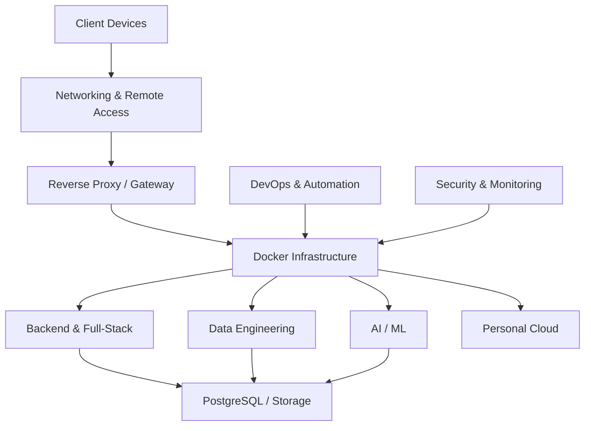

# 🏠 Homelab

### Personal Engineering Lab · Self-Hosted Infrastructure · Learning by Building

<p align="center">
  
  
  
  
</p>

A personal self-hosted engineering environment built to explore, develop, deploy, automate, and manage real-world applications and infrastructure.

This project transforms a spare laptop into a multi-purpose homelab spanning **Backend Development, Data Engineering, DevOps, AI/ML Infrastructure, Personal Cloud, and Cybersecurity.**

The goal is simple: understand how modern computing infrastructure works by building and managing it myself.

---

## 📑 Table of Contents

- [Overview](#-overview)
- [Hardware](#-hardware)
- [Architecture](#-architecture)
- [Core Services](#-core-services)
- [Technology Stack](#-technology-stack)
- [Roadmap](#-roadmap)
- [Repository Structure](#-repository-structure)
- [Learning Philosophy](#-learning-philosophy)
- [Security](#-security)
- [Current Progress](#-current-progress)

---

## 🎯 Overview

The homelab is organized into six interconnected engineering domains.

| Domain | Primary Objective |
|:---|:---|
| 🌐 Backend & Full-Stack | Build and deploy web applications and APIs |
| 🔄 Data Engineering | Design automated data pipelines |
| ⚙️ DevOps & Infrastructure | Automate deployment and infrastructure |
| 🤖 AI/ML Infrastructure | Experiment with model training and deployment |
| ☁️ Personal Cloud | Build private self-hosted services |
| 🔐 Cybersecurity & Networking | Secure and monitor the infrastructure |

All services will share a common foundation of Linux, Docker, networking, and persistent storage.

---

## 💻 Hardware

The lab runs on repurposed hardware rather than dedicated server equipment.

| Component | Specification |
|:---|:---|
| Processor | Intel Core i3 |
| Memory | 8 GB RAM |
| Storage | 512 GB SSD |
| Graphics | Integrated Graphics |
| Operating System | Ubuntu Linux |
| Deployment Environment | Docker / Docker Compose |

**Design constraint:** Limited hardware resources. Services will be deployed selectively, with an emphasis on lightweight configurations, resource optimization, and efficient service management.

---

## 🏗️ Architecture

The infrastructure follows a layered approach



### Infrastructure Principles

- Containerized service deployment.
- Persistent storage for stateful applications.
- Centralized configuration management.
- Secure LAN and remote access.
- Automated backups and recovery.
- Resource-conscious service orchestration.

---

## 🧩 Core Services

### 01 · Backend & Full-Stack Development
**Objective:** Build, host, and manage full-stack applications.

- REST API development
- Backend application deployment
- PostgreSQL integration
- Reverse proxy configuration
- HTTPS and domain management

**Planned technologies:** Python, FastAPI, PostgreSQL, Docker, Nginx.

### 02 · Data Engineering
**Objective:** Build automated, end-to-end data pipelines.

- Data ingestion and extraction
- ETL / ELT pipelines
- Workflow orchestration
- Data transformation
- Data warehousing

**Planned technologies:** Python, SQL, Apache Airflow, dbt.

### 03 · DevOps & Infrastructure
**Objective:** Automate application deployment and infrastructure management.

- Container orchestration
- CI/CD pipelines
- Automated testing
- Deployment automation
- Infrastructure monitoring

**Planned technologies:** Docker Compose, Git, GitHub Actions, Prometheus, Grafana.

### 04 · AI/ML Infrastructure
**Objective:** Develop and deploy machine learning workflows.

- Model experimentation
- Data preprocessing
- Model training
- Experiment tracking
- Model serving and API integration

**Planned technologies:** Python, JupyterLab, Scikit-learn, MLflow.

### 05 · Personal Cloud
**Objective:** Build a private cloud environment.

- File synchronization
- Personal storage
- Backup automation
- Remote access
- Self-hosted applications

**Planned technologies:** Nextcloud, Docker, Tailscale.

### 06 · Cybersecurity & Networking
**Objective:** Understand, secure, and monitor the homelab infrastructure.

- Linux system hardening
- SSH authentication
- Firewall configuration
- Network segmentation
- VPN and remote access
- Network monitoring

**Planned technologies:** OpenSSH, UFW, WireGuard, Tailscale, Wireshark.

---

## 🛠️ Technology Stack

| Category | Technologies |
|:---|:---|
| Operating System | Ubuntu Linux |
| Version Control | Git, GitHub |
| Containers | Docker, Docker Compose |
| Backend | Python, FastAPI |
| Database | PostgreSQL |
| Web Infrastructure | Nginx |
| Data Engineering | Python, SQL, Airflow, dbt |
| DevOps | GitHub Actions |
| Machine Learning | Scikit-learn, MLflow |
| Notebooks | JupyterLab |
| Personal Cloud | Nextcloud |
| Networking | SSH, WireGuard, Tailscale |
| Monitoring | Prometheus, Grafana |

*Technologies will be introduced progressively as the lab develops.*

---

## 🗺️ Development Roadmap

The project follows a progressive 32-week development plan.

| Phase | Duration | Status |
|:---|:---:|:---:|
| 01 · Backend & Full-Stack | 5 weeks | 🔄 Planned |
| 02 · Data Engineering | 6 weeks | ⏳ Planned |
| 03 · DevOps & Infrastructure | 5 weeks | ⏳ Planned |
| 04 · AI/ML Infrastructure | 5 weeks | ⏳ Planned |
| 05 · Personal Cloud | 4 weeks | ⏳ Planned |
| 06 · Cybersecurity & Networking | 5 weeks | ⏳ Planned |
| 07 · Integration & Documentation | 2 weeks | ⏳ Planned |

### Development Methodology

Each phase follows three stages:

1. **Learn** — Understand the underlying concepts.
2. **Build** — Implement and deploy working services.
3. **Document** — Record architecture, configurations, troubleshooting, and lessons learned.

---

## 📂 Repository Structure

```text
homelab/
│
├── docs/
│   ├── architecture/
│   ├── networking/
│   └── setup-guides/
│
├── infrastructure/
│   ├── docker/
│   ├── nginx/
│   └── networking/
│
├── services/
│   ├── backend/
│   ├── data-engineering/
│   ├── devops/
│   ├── ai-ml/
│   ├── personal-cloud/
│   └── cybersecurity/
│
├── projects/
├── scripts/
├── notes/
│
├── .gitignore
└── README.md
```

---

## 📚 Learning Philosophy

This is not just a collection of self-hosted applications.

The focus is on understanding the systems underneath them.

- Learn Linux beyond basic terminal commands.
- Understand Docker beyond running containers.
- Understand networking beyond connecting devices.
- Learn databases beyond writing SQL queries.
- Understand deployment beyond pushing code.
- Learn security as an integral part of infrastructure.

Every implementation should contribute to a deeper understanding of computer systems and practical engineering.

---

## 🔐 Security Principles

- Never commit passwords, API keys, tokens, or private keys.
- Use environment variables for sensitive configuration.
- Keep secrets outside version control.
- Use SSH key authentication.
- Minimize publicly exposed services.
- Secure remote access through VPN where appropriate.
- Maintain regular backups.

---

## 📊 Current Progress

**Project status:** In Development

Current foundations:

- [x] Ubuntu Linux environment
- [x] Git and GitHub configuration
- [x] Docker fundamentals
- [x] Docker networking fundamentals
- [x] PostgreSQL fundamentals
- [ ] Backend application deployment
- [ ] Data engineering pipeline
- [ ] CI/CD automation
- [ ] ML infrastructure
- [ ] Personal cloud
- [ ] Security hardening

---

<p align="center">
  <b>Built with curiosity, maintained with discipline.</b>
  <br/>
  <sub>A long-term journey into systems, infrastructure, and engineering.</sub>
</p>